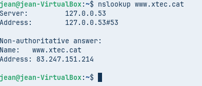
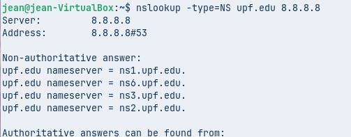
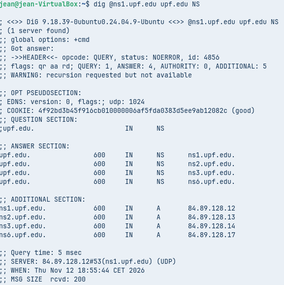
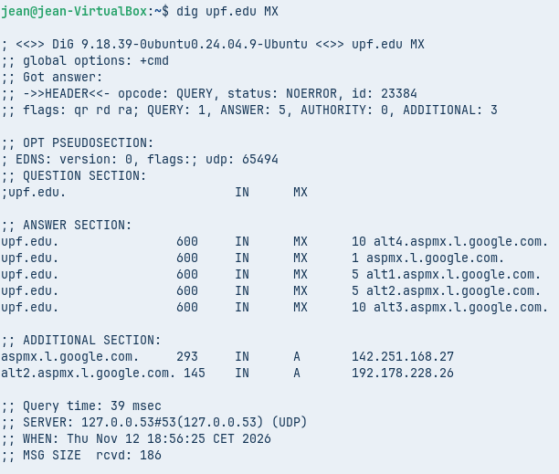
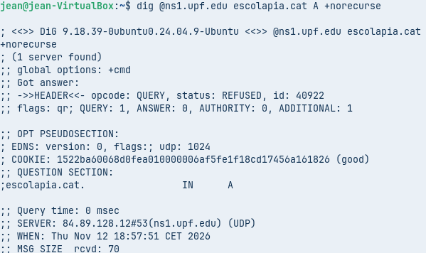
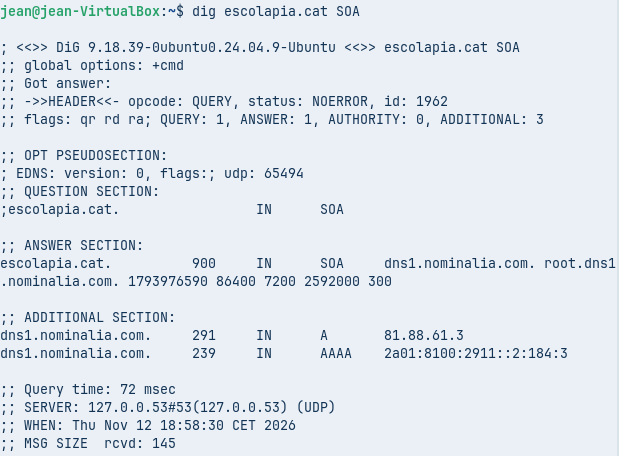
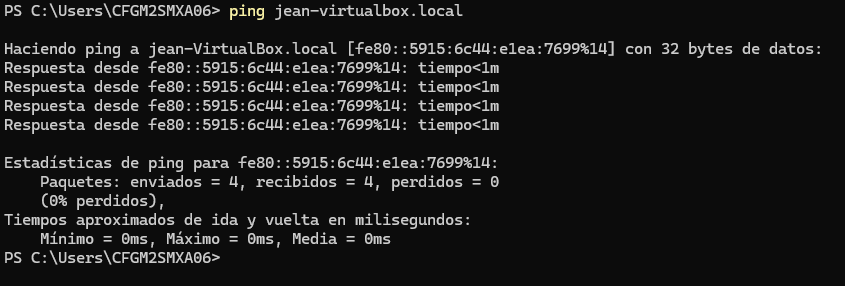

# Pràctica de DNS i mDNS

## Objectiu

Practicar consultes DNS amb `nslookup` i `dig`, identificar respostes autoritatives i no autoritatives, consultar registres NS, MX i SOA, i comprovar la resolució de noms mitjançant mDNS.


## 1. Consultar la IP de `www.xtec.cat`

**Comanda:**

```bash
nslookup www.xtec.cat
```

**Resultat observat:**

- Servidor DNS configurat: `127.0.0.53`.
- Resposta no autoritativa (*Non-authoritative answer*).
- Adreça IPv4 retornada: `83.247.151.214`.

La resposta és no autoritativa perquè el servidor local de resolució ha obtingut la informació d'un altre servidor DNS i no és el servidor autoritatiu del domini.



## 2. Consultar els servidors NS de `upf.edu` mitjançant Google DNS

**Comanda:**

```bash
nslookup -type=NS upf.edu 8.8.8.8
```

**Resultat observat:**

El servidor consultat és Google DNS (`8.8.8.8`) i la resposta és no autoritativa. Es mostren aquests servidors de noms:

- `ns1.upf.edu`
- `ns6.upf.edu`
- `ns3.upf.edu`
- `ns2.upf.edu`

Això identifica els servidors NS publicats per al domini `upf.edu`.



## 3. Consultar `upf.edu` directament a un dels seus servidors DNS

**Comanda:**

```bash
dig @ns1.upf.edu upf.edu NS
```

**Resultat observat:**

La consulta retorna els registres NS de `upf.edu` i l'estat és `NOERROR`. A la capçalera es veuen les banderes `qr rd ra`, però **no hi apareix la bandera `aa`** (*Authoritative Answer*).

Per tant, aquesta captura no demostra que la resposta sigui autoritativa, tot i que s'ha consultat `ns1.upf.edu`. Cal tenir en compte aquest detall si l'enunciat demana comprovar una resposta autoritativa.



## 4. Consultar els servidors de correu de `upf.edu`

**Comanda:**

```bash
dig upf.edu MX
```

**Resultat observat:**

La consulta retorna cinc registres MX. Els valors de preferència observats són `10`, `1`, `5`, `5` i `10`, associats a servidors del servei de correu de Google (`aspmx.l.google.com` i servidors alternatius `alt*.aspmx.l.google.com`).

La preferència més baixa indica el servidor que té prioritat més alta per rebre el correu.



## 5. Consultar `escolapia.cat` des del servidor DNS de la UPF

**Comanda:**

```bash
dig @ns1.upf.edu escolapia.cat A +norecurse
```

**Resultat observat:**

El servidor `ns1.upf.edu` retorna l'estat `REFUSED`, amb zero respostes a la secció ANSWER. Això indica que el servidor rebutja aquesta consulta; no proporciona una resposta autoritativa per al domini `escolapia.cat`.

La captura mostra que no s'ha obtingut cap registre A del domini des del servidor DNS de la UPF.



## 6. Mostrar el registre SOA de `escolapia.cat`

**Comanda:**

```bash
dig escolapia.cat SOA
```

**Resultat observat:**

La resposta inclou un registre SOA (*Start of Authority*) amb les dades següents:

- **Servidor principal (MNAME):** `dns1.nominalia.com`.
- **Correu de l'administrador (RNAME):** `root.dns1.nominalia.com`.
- **Número de sèrie:** `1793796590`.
- **Refresh:** `86400` segons.
- **Retry:** `7200` segons.
- **Expire:** `2592000` segons.
- **Minimum:** `800` segons.

El registre SOA conté informació administrativa i paràmetres de sincronització de la zona DNS.



## 7. Consulta mDNS entre màquines

**Comanda que es veu a la captura:**

```powershell
ping jean-VirtualBox.local
```

**Resultat observat:**

La màquina resol el nom `jean-VirtualBox.local` a l'adreça IPv6 local d'enllaç:

`fe80::5915:6c44:ee1a:7699%14`

Les quatre peticions reben resposta i no hi ha paquets perduts. El sufix `.local` s'utilitza habitualment per a la resolució de noms mDNS.

**Nota sobre la captura:** el terminal de la imatge és Windows PowerShell (`PS C:\...`), no una terminal Linux. Per tant, documenta una resolució mDNS des de Windows cap a un equip amb nom `jean-VirtualBox.local`, però no demostra per si sola una consulta entre dues màquines virtuals Linux. Si el professor exigeix dues màquines virtuals, caldria repetir la prova des de la primera VM Linux amb `avahi-resolve-host-name nom-de-la-segona.local` i adjuntar-ne la captura.



